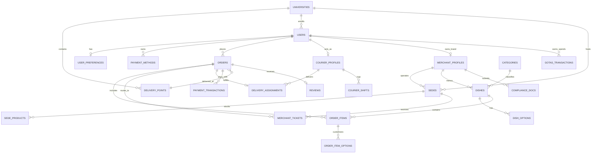

# Modelo de Base de Datos - BIFFY Delivery Platform 🐝

Este documento define la arquitectura conceptual, lógica y física del modelo de datos para **BIFFY**, una plataforma de entrega hiperlocal optimizada para campus universitarios y áreas metropolitanas de alta densidad.

Diseñado para implementarse sobre **PostgreSQL 15+** (nativo en **Supabase**), con soporte para extensiones geoespaciales (**PostGIS**), seguridad a nivel de filas (**Row Level Security - RLS**) y sincronización en tiempo real (**Supabase Realtime / WebSockets**).

---

## 1. Diagrama Entidad-Relación (ERD)



---

## 2. Entidades Principales y Diccionario de Datos

### 2.1 Módulo de Usuarios y Autenticación (`auth` & `profiles`)

#### `users` (Extensión del esquema `auth.users` de Supabase)
| Campo | Tipo | Restricción | Descripción |
|---|---|---|---|
| `id` | UUID | PK, NOT NULL | Identificador único del usuario (vinculado a Supabase Auth). |
| `email` | VARCHAR(255) | UNIQUE, NOT NULL | Correo electrónico principal. |
| `phone` | VARCHAR(20) | NULL | Teléfono con indicativo (+57). |
| `full_name` | VARCHAR(120) | NOT NULL | Nombre y apellido. |
| `avatar_url` | TEXT | NULL | URL del avatar o foto de perfil. |
| `career` | VARCHAR(120) | NULL | Carrera académica (si aplica). |
| `university_id` | UUID | FK -> `universities.id`, NULL | Universidad a la que pertenece. |
| `is_student_verified` | BOOLEAN | DEFAULT FALSE | Verificado con correo institucional (`.edu.co`). |
| `current_role` | ENUM | 'student', 'courier', 'merchant', 'admin' | Rol activo actual en la interfaz. |
| `gotas_balance` | INTEGER | DEFAULT 0, CHECK (gotas_balance >= 0) | Saldo actual de puntos/Gotas Biffy. |
| `created_at` | TIMESTAMPTZ | DEFAULT NOW() | Fecha de registro. |
| `updated_at` | TIMESTAMPTZ | DEFAULT NOW() | Última modificación. |

#### `user_preferences`
| Campo | Tipo | Restricción | Descripción |
|---|---|---|---|
| `user_id` | UUID | PK, FK -> `users.id` | Usuario titular. |
| `likes` | TEXT[] | DEFAULT '{}' | Categorías favoritas (ej. `['pizza', 'hamburguesa']`). |
| `allergies` | TEXT[] | DEFAULT '{}' | Alérgenos a filtrar (ej. `['gluten', 'lacteos', 'mani']`). |
| `lifestyle` | TEXT[] | DEFAULT '{}' | Estilo de vida (ej. `['vegano', 'alto en proteina']`). |
| `budget_max` | DECIMAL(10,2) | DEFAULT 25000 | Presupuesto promedio sugerido por comida (COP). |
| `survey_completed` | BOOLEAN | DEFAULT FALSE | Indica si completó la encuesta para ganar 300 Gotas. |

---

### 2.2 Módulo de Universidades y Puntos de Entrega Campus

#### `universities`
| Campo | Tipo | Restricción | Descripción |
|---|---|---|---|
| `id` | VARCHAR(50) | PK | Código o identificador (ej. `'unal'`, `'uniandes'`). |
| `name` | VARCHAR(150) | NOT NULL | Nombre oficial (ej. "Universidad Nacional de Colombia"). |
| `domain` | VARCHAR(100) | NOT NULL | Dominio de correo permitido (ej. `'unal.edu.co'`). |
| `center_lat` | DOUBLE PRECISION | NOT NULL | Latitud del centro del campus. |
| `center_lng` | DOUBLE PRECISION | NOT NULL | Longitud del centro del campus. |
| `boundary_polygon` | GEOMETRY(Polygon, 4326) | NULL | Polígono perimetral del campus (PostGIS). |
| `is_active` | BOOLEAN | DEFAULT TRUE | Campus activo para entregas. |

#### `delivery_points` (Puntos de Encuentro Clave)
| Campo | Tipo | Restricción | Descripción |
|---|---|---|---|
| `id` | VARCHAR(50) | PK | Identificador amigable (ej. `'biblio'`, `'inge'`). |
| `university_id` | VARCHAR(50) | FK -> `universities.id`, NULL | Universidad a la que pertenece (NULL si es urbano). |
| `name` | VARCHAR(120) | NOT NULL | Nombre reconocible (ej. "Biblioteca Central"). |
| `detail` | VARCHAR(255) | NOT NULL | Indicación exacta (ej. "Entrada principal, junto a bancas"). |
| `location` | GEOMETRY(Point, 4326) | NOT NULL | Coordenadas PostGIS (latitud/longitud). |
| `lat` | DOUBLE PRECISION | NOT NULL | Latitud para fallback directo. |
| `lng` | DOUBLE PRECISION | NOT NULL | Longitud para fallback directo. |
| `is_active` | BOOLEAN | DEFAULT TRUE | Punto habilitado. |

---

### 2.3 Módulo de Restaurantes, Sedes y Menús

#### `merchant_profiles` (Marca Comercial y Legal)
| Campo | Tipo | Restricción | Descripción |
|---|---|---|---|
| `id` | UUID | PK, DEFAULT uuid_generate_v4() | Identificador de la marca/empresa. |
| `owner_id` | UUID | FK -> `users.id`, NOT NULL | Usuario propietario del restaurante. |
| `brand_name` | VARCHAR(120) | NOT NULL | Nombre público de la marca (ej. "La Plazoleta Pizza"). |
| `legal_name` | VARCHAR(180) | NOT NULL | Razón social registrada ante DIAN. |
| `nit` | VARCHAR(30) | NOT NULL | Número de Identificación Tributaria con dígito de verificación. |
| `person_type` | ENUM | 'natural', 'juridica' | Tipo de persona tributaria. |
| `inc_responsible` | BOOLEAN | DEFAULT FALSE | ¿Responsable de Impuesto Nacional al Consumo (8%)? |
| `commission_rate` | DECIMAL(4,2) | DEFAULT 0.15 | Tarifa de comisión pactada con Biffy (15%). |
| `cuisine_category` | VARCHAR(50) | NOT NULL | Especialidad culinaria principal. |
| `logo_url` | TEXT | NULL | URL del logotipo. |
| `shows_nutrition` | BOOLEAN | DEFAULT FALSE | Muestra tablas nutricionales en la app. |
| `status` | ENUM | 'pending', 'approved', 'suspended' | Estado de validación legal. |

#### `sedes` (Puntos de Venta y Cocinas Físicas)
| Campo | Tipo | Restricción | Descripción |
|---|---|---|---|
| `id` | UUID | PK, DEFAULT uuid_generate_v4() | Identificador de la sede. |
| `merchant_id` | UUID | FK -> `merchant_profiles.id` | Marca a la que pertenece. |
| `name` | VARCHAR(120) | NOT NULL | Nombre de la sede (ej. "Campus UNAL - Plazoleta B"). |
| `address` | VARCHAR(255) | NOT NULL | Dirección física o ubicación en campus. |
| `city` | VARCHAR(80) | DEFAULT 'Bogotá' | Ciudad. |
| `phone` | VARCHAR(30) | NOT NULL | Teléfono de contacto de cocina. |
| `location` | GEOMETRY(Point, 4326) | NOT NULL | Ubicación geoespacial exacta (lat/lng). |
| `lat` | DOUBLE PRECISION | NOT NULL | Latitud. |
| `lng` | DOUBLE PRECISION | NOT NULL | Longitud. |
| `radius_km` | DECIMAL(3,1) | DEFAULT 2.5 | Radio máximo de entrega en kilómetros. |
| `campus_id` | VARCHAR(50) | FK -> `universities.id`, NULL | Si está dentro o asociada a un campus. |
| `student_discount` | DECIMAL(3,2) | DEFAULT 0.00 | Descuento para estudiantes verificados (0.10 = 10%). |
| `open_hour` | INTEGER | CHECK (0..23) | Hora de apertura (formato 24h). |
| `close_hour` | INTEGER | CHECK (0..23) | Hora de cierre (formato 24h). |
| `closed_days` | INTEGER[] | DEFAULT '{}' | Días de cierre (0=Dom, 1=Lun, ..., 6=Sáb). |
| `is_paused` | BOOLEAN | DEFAULT FALSE | Pausa manual de cocina por saturación. |

#### `dishes` (Productos / Platos del Menú)
| Campo | Tipo | Restricción | Descripción |
|---|---|---|---|
| `id` | UUID | PK, DEFAULT uuid_generate_v4() | Identificador del plato. |
| `merchant_id` | UUID | FK -> `merchant_profiles.id` | Marca creadora. |
| `name` | VARCHAR(150) | NOT NULL | Nombre del plato (ej. "Pizza Margarita"). |
| `description` | TEXT | NULL | Descripción de ingredientes y preparación. |
| `category_id` | VARCHAR(50) | FK -> `categories.id` | Categoría (pizza, hamburguesa, saludable...). |
| `section` | VARCHAR(80) | NOT NULL | Sección del menú (ej. "Pizzas", "Bebidas"). |
| `price` | DECIMAL(10,2) | NOT NULL, CHECK (price > 0) | Precio base al consumidor en COP (INC incluido). |
| `prep_min` | INTEGER | DEFAULT 15 | Tiempo promedio de preparación en minutos. |
| `calories` | INTEGER | DEFAULT 0 | Calorías estimadas (kcal). |
| `nutrition_info` | JSONB | NULL | Macronutrientes `{ kcal, protein, carbs, fat }`. |
| `tags` | TEXT[] | DEFAULT '{}' | Etiquetas (`vegano`, `sin gluten`, `alto en proteina`). |
| `allergens` | TEXT[] | DEFAULT '{}' | Alérgenos (`gluten`, `lacteos`, `mani`, `huevo`, `soya`). |
| `photo_url` | TEXT | NULL | URL de la imagen principal. |
| `is_popular` | BOOLEAN | DEFAULT FALSE | Destacado en catálogo. |
| `is_available` | BOOLEAN | DEFAULT TRUE | Disponible para ordenar. |

#### `dish_options` (Variantes y Adiciones)
| Campo | Tipo | Restricción | Descripción |
|---|---|---|---|
| `id` | UUID | PK, DEFAULT uuid_generate_v4() | Identificador de la adición. |
| `dish_id` | UUID | FK -> `dishes.id` | Plato asociado. |
| `group_name` | VARCHAR(80) | DEFAULT 'Opciones' | Grupo (ej. "Elige tu proteína", "Adiciones"). |
| `label` | VARCHAR(120) | NOT NULL | Texto de la opción (ej. "Borde de queso bocadillo"). |
| `price` | DECIMAL(10,2) | DEFAULT 0.00 | Costo adicional en COP. |
| `is_required` | BOOLEAN | DEFAULT FALSE | Obligatorio seleccionar al menos una. |

---

### 2.4 Módulo de Pedidos y Logística (`orders` & `fulfillment`)

#### `orders` (Pedido General del Cliente)
| Campo | Tipo | Restricción | Descripción |
|---|---|---|---|
| `id` | VARCHAR(20) | PK | Código amigable (ej. `'BF-4819'`). |
| `user_id` | UUID | FK -> `users.id` | Cliente que realizó la compra. |
| `delivery_point_id`| VARCHAR(50) | FK -> `delivery_points.id` | Punto de entrega seleccionado. |
| `subtotal` | DECIMAL(10,2) | NOT NULL | Suma de precios base y opciones. |
| `student_discount` | DECIMAL(10,2) | DEFAULT 0.00 | Ahorro aplicado por verificación de campus. |
| `delivery_fee` | DECIMAL(10,2) | NOT NULL | Costo del domicilio (ej. $1.500 campus / $3.500 externo). |
| `points_discount` | DECIMAL(10,2) | DEFAULT 0.00 | Descuento obtenido con Gotas redimidas. |
| `points_used` | INTEGER | DEFAULT 0 | Cantidad de Gotas consumidas. |
| `total` | DECIMAL(10,2) | NOT NULL | Total final a cobrar. |
| `status` | ENUM | 'programado', 'confirmado', 'preparando', 'en_camino', 'entregado', 'cancelado' | Estado global del pedido. |
| `payment_method_id`| VARCHAR(50) | NOT NULL | ID del método de pago (`card_xxx`, `nequi`, `cash`). |
| `payment_status` | ENUM | 'pending', 'paid', 'failed', 'refunded' | Estado de la transacción financiera. |
| `client_security_code` | VARCHAR(4) | NOT NULL | Código PIN de 4 dígitos para recibir el pedido. |
| `scheduled_for` | TIMESTAMPTZ | NULL | Fecha/hora ISO si fue programado para después. |
| `created_at` | TIMESTAMPTZ | DEFAULT NOW() | Fecha de creación. |
| `delivered_at` | TIMESTAMPTZ | NULL | Fecha de entrega efectiva. |

#### `order_items`
| Campo | Tipo | Restricción | Descripción |
|---|---|---|---|
| `id` | UUID | PK, DEFAULT uuid_generate_v4() | Identificador de línea. |
| `order_id` | VARCHAR(20) | FK -> `orders.id` | Pedido padre. |
| `dish_id` | UUID | FK -> `dishes.id` | Plato solicitado. |
| `sede_id` | UUID | FK -> `sedes.id` | Sede que lo elabora. |
| `quantity` | INTEGER | NOT NULL, CHECK (quantity > 0) | Cantidad de unidades. |
| `unit_price` | DECIMAL(10,2) | NOT NULL | Precio unitario fijado al momento de la compra. |
| `notes` | TEXT | NULL | Instrucciones especiales del comensal. |
| `selected_options` | JSONB | DEFAULT '[]' | Snapshots de opciones elegidas con su precio. |

#### `merchant_tickets` (Comandas de Cocina por Sede)
| Campo | Tipo | Restricción | Descripción |
|---|---|---|---|
| `id` | VARCHAR(30) | PK | Identificador (ej. `'BF-4819-s1'`). |
| `order_id` | VARCHAR(20) | FK -> `orders.id` | Pedido padre. |
| `sede_id` | UUID | FK -> `sedes.id` | Sede receptora. |
| `status` | ENUM | 'nuevo', 'preparando', 'listo', 'en_camino', 'entregado', 'rechazado' | Estado en cocina. |
| `reject_reason` | TEXT | NULL | Razón si el comercio no puede atender el pedido. |
| `ready_at` | TIMESTAMPTZ | NULL | Marca de tiempo cuando el plato estuvo listo. |

---

### 2.5 Módulo de Repartidores y Entregas (`couriers` & `dispatch`)

#### `courier_profiles`
| Campo | Tipo | Restricción | Descripción |
|---|---|---|---|
| `id` | UUID | PK, FK -> `users.id` | Usuario con perfil de repartidor. |
| `vehicle_type` | ENUM | 'bicicleta', 'moto', 'pie' | Medio de transporte. |
| `preferred_zone` | ENUM | 'campus', 'general' | Zona de operación elegida. |
| `is_online` | BOOLEAN | DEFAULT FALSE | Disponible para recibir órdenes en tiempo real. |
| `current_lat` | DOUBLE PRECISION | NULL | Última latitud reportada. |
| `current_lng` | DOUBLE PRECISION | NULL | Última longitud reportada. |
| `rating_average` | DECIMAL(3,2) | DEFAULT 5.00 | Calificación promedio histórica (1 a 5). |
| `total_rides` | INTEGER | DEFAULT 0 | Carreras acumuladas. |
| `pending_platform_fee` | DECIMAL(10,2) | DEFAULT 0.00 | Comisión pendiente que debe abonar a Biffy (10%). |

#### `delivery_assignments`
| Campo | Tipo | Restricción | Descripción |
|---|---|---|---|
| `id` | UUID | PK, DEFAULT uuid_generate_v4() | Identificador de asignación. |
| `order_id` | VARCHAR(20) | FK -> `orders.id`, UNIQUE | Pedido a repartir. |
| `courier_id` | UUID | FK -> `courier_profiles.id` | Repartidor asignado. |
| `pickup_code` | VARCHAR(4) | NOT NULL | PIN para reclamar en restaurante. |
| `courier_earnings` | DECIMAL(10,2) | NOT NULL | Pago que recibe el repartidor por esta carrera. |
| `proof_photo_url` | TEXT | NULL | Foto tomada al entregar como evidencia. |
| `status` | ENUM | 'assigned', 'picked_up', 'delivered', 'failed' | Estado de la entrega. |
| `accepted_at` | TIMESTAMPTZ | DEFAULT NOW() | Hora de aceptación. |
| `picked_up_at` | TIMESTAMPTZ | NULL | Hora de recogida en restaurante. |
| `delivered_at` | TIMESTAMPTZ | NULL | Hora de entrega al cliente. |

---

### 2.6 Módulo de Métodos de Pago y Transacciones (`payments`)

#### `payment_methods` (Tarjetas y Cuentas Tokenizadas)
| Campo | Tipo | Restricción | Descripción |
|---|---|---|---|
| `id` | VARCHAR(60) | PK | ID interno o token de pasarela (ej. `'card_bf92a1'`). |
| `user_id` | UUID | FK -> `users.id` | Titular del medio de pago. |
| `type` | ENUM | 'card', 'nequi', 'daviplata', 'pse', 'cash' | Tipo de método de pago. |
| `card_brand` | ENUM | 'visa', 'mastercard', 'amex', 'other', NULL | Franquicia detectada. |
| `last4` | VARCHAR(4) | NULL | Últimos 4 dígitos de la tarjeta o número de cuenta. |
| `cardholder_name`| VARCHAR(120) | NULL | Nombre impreso en la tarjeta. |
| `exp_month` | VARCHAR(2) | NULL | Mes de vencimiento (MM). |
| `exp_year` | VARCHAR(4) | NULL | Año de vencimiento (AAAA). |
| `gateway_token` | TEXT | NULL | Token seguro provisto por Wompi/Stripe/MercadoPago. |
| `is_default` | BOOLEAN | DEFAULT FALSE | Método preferido para compras rápidas. |

#### `payment_transactions`
| Campo | Tipo | Restricción | Descripción |
|---|---|---|---|
| `id` | UUID | PK, DEFAULT uuid_generate_v4() | Identificador de la transacción. |
| `order_id` | VARCHAR(20) | FK -> `orders.id` | Pedido relacionado. |
| `payment_method_id`| VARCHAR(60) | NOT NULL | Método de pago utilizado. |
| `amount` | DECIMAL(10,2) | NOT NULL | Monto cobrado en COP. |
| `gateway_provider` | ENUM | 'wompi', 'epayco', 'stripe', 'mock_gateway' | Pasarela procesadora. |
| `gateway_ref` | VARCHAR(100) | NULL | ID de referencia retornado por la pasarela. |
| `status` | ENUM | 'pending', 'approved', 'declined', 'error' | Resultado de la transacción. |
| `error_message` | TEXT | NULL | Mensaje de rechazo en caso de fondos insuficientes/cvv. |
| `created_at` | TIMESTAMPTZ | DEFAULT NOW() | Fecha de procesamiento. |

---

## 3. Seguridad y Políticas de Acceso (Row Level Security - RLS)

En PostgreSQL/Supabase, las políticas RLS garantizan que ningún usuario pueda ver o modificar datos de otro rol:

1. **Clientes (`student` / `client`)**:
   - Pueden leer restaurantes activos, sedes dentro de su radio, menús y categorías.
   - Solo pueden ver y crear sus propios `orders`, `cart`, `payment_methods` y `reviews`.
   - Solo pueden leer sus propias transacciones de `gotas_transactions`.

2. **Repartidores (`courier`)**:
   - Pueden leer ofertas de entrega disponibles en su zona (`campus` o `general`).
   - Solo pueden actualizar el estado de los pedidos que tienen asignados formalmente en `delivery_assignments`.
   - No tienen acceso a datos bancarios privados de restaurantes ni números de tarjeta de clientes.

3. **Restaurantes / Comercios (`merchant`)**:
   - Solo pueden ver y editar los productos y sedes vinculados a su `merchant_id`.
   - Solo pueden leer las comandas que pertenecen a sus sedes (`merchant_tickets`).
   - Pueden cambiar el estado de los tickets de su cocina (`nuevo` -> `preparando` -> `listo`).

4. **Administradores (`admin`)**:
   - Acceso de auditoría para verificar documentos de restaurantes (RUT, concepto sanitario) y validar cuentas de repartidores.

---

## 4. Consultas Clave Geoespaciales (Regla de Micro-Radio `isReachable`)

En SQL nativo con la extensión **PostGIS**, la visibilidad de restaurantes y platos se calcula eficientemente con índices espaciales GIST:

```sql
-- Obtener restaurantes accesibles para un estudiante ubicado en un punto de entrega específico:
SELECT 
    r.id AS restaurant_id,
    r.name,
    s.id AS sede_id,
    s.name AS sede_name,
    s.radius_km,
    ST_DistanceSphere(s.location, p.location) / 1000.0 AS distance_km,
    (SELECT COUNT(*) FROM courier_profiles c 
     WHERE c.is_online = true 
       AND ST_DWithin(c.location, s.location, 2500)
    ) AS couriers_nearby
FROM sedes s
JOIN merchant_profiles r ON s.merchant_id = r.id
JOIN delivery_points p ON p.id = 'biblio' -- Punto seleccionado
WHERE s.is_paused = false
  AND r.status = 'approved'
  AND ST_DWithin(s.location, p.location, s.radius_km * 1000)
ORDER BY distance_km ASC;
```

---

## 5. Eventos en Tiempo Real (Supabase Realtime)

| Canal / Tabla | Evento | Emisor | Receptores | Acción en Frontend |
|---|---|---|---|---|
| `orders:id` | `UPDATE (status)` | Servidor / Repartidor | Cliente | Mueve la barra de progreso en `pedido.$id.tsx`. |
| `merchant_tickets:sede_id` | `INSERT` | Checkout Cliente | Pantalla Comercio | Suena la campana de nuevo pedido en KDS. |
| `delivery_offers:zone` | `INSERT` | Cocina lista | Repartidores online | Muestra tarjeta de oferta con countdown de 18s. |
| `courier_profiles:location` | `UPDATE` | GPS Repartidor | Cliente en seguimiento | Actualiza la posición de la moto/bici en el mapa. |
